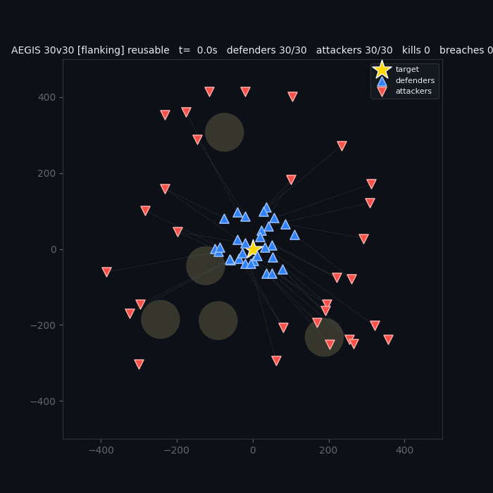
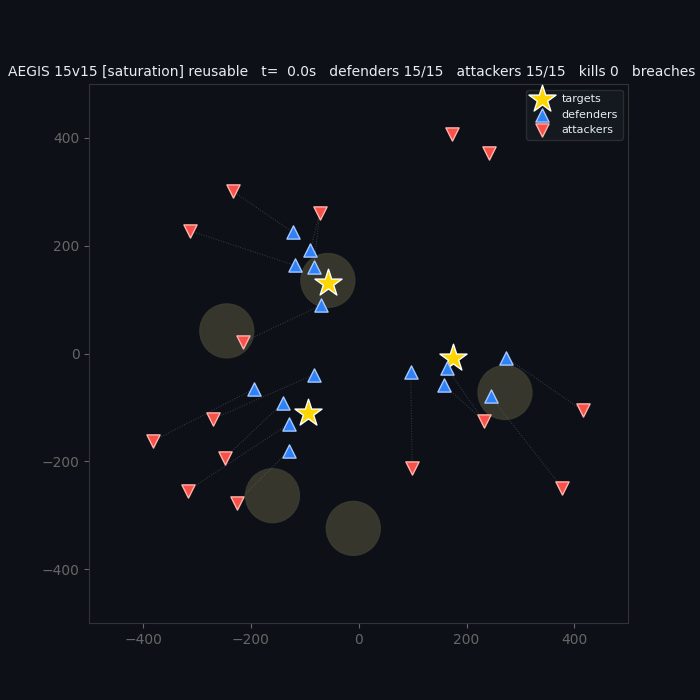
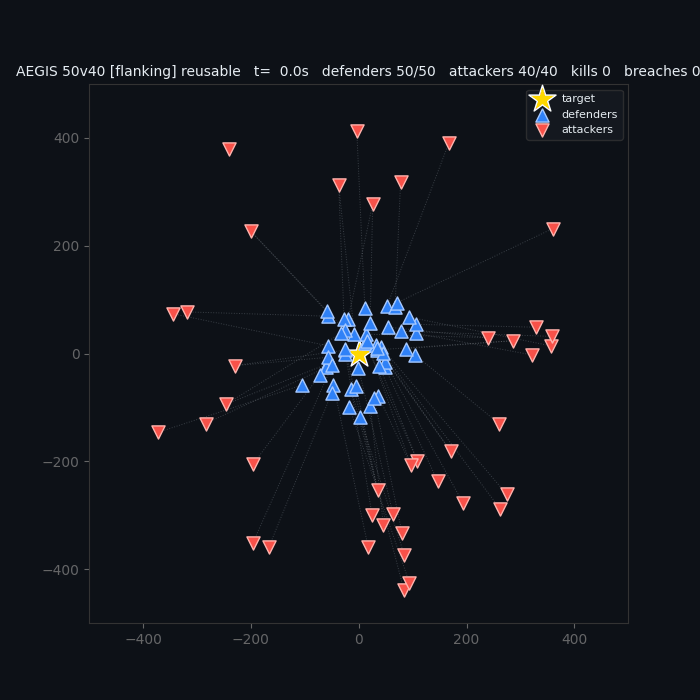

# AEGIS: a learned interceptor swarm for drone defense

AEGIS trains a swarm of interceptor drones to protect one or more points against incoming attack
drones. One PPO policy, shared by every defender, flies each drone from a 56-dimensional
ego-centric observation; a classical allocator inside the environment assigns defenders to
attackers with the Hungarian algorithm. In simulation the same policy wins 98–100% of
single-target engagements from 1v1 to 20v20, holds 100% with zero leakers at 50v40 and when
outnumbered 20v40 without having trained at those sizes, and a single checkpoint defends one to
four protected points. A deployment path to CrazyFlie 2.1 nano-drones is built and verified in
simulation and software dry runs; it has **not yet flown on hardware**.

**Paper:** [paper.pdf](paper.pdf) is a 2-page write-up of the design, the results and how the project got here
([LaTeX source](paper.tex); [`figures/make_figures.py`](figures/make_figures.py) rebuilds its figures from the
tracked evaluation CSVs and replays).

<p align="center">
  
  <br>
  <sub>30v30 flanking raid in hills terrain, policy <code>aegis_big24</code> (trained up to 24v24). Blue: defenders; red: attackers;
  dotted lines: current allocator assignments; crosses: eliminated drones; star: protected point.</sub>
</p>

## Key results

Simulation only: fixed seeds, deterministic policy, reusable interceptors (a defender survives an
intercept and rearms for 2 s). *Win*: all attackers eliminated, none reaches a protected point.
*Leakers*: attackers per episode that reach one. *Attrition*: share of defenders lost to terrain,
ground or arena bounds. *Realism*: five hills, wind (0.5 N, gusts to 1.5 N), Gaussian noise
(σ = 0.02) on normalized observations, 300 m detection range. Summary: [docs/CAPABILITIES.md](docs/CAPABILITIES.md).

| Capability | Result | Conditions |
|---|---|---|
| Single target, 1v1 to 20v20 | 98% win at 1v1; 100% win and 0.00 leakers at 3v3, 5v5, 7v5, 10v10, 15v15, 20v20; attrition 2–4% | realism; n=100 per cell and raid type (direct, saturation) |
| Larger than any training swarm (training never exceeded 24v24) | 100% win, 0.00 leakers at 30v30, 40v40 and 50v40 (90 drones) | open field; n=60 per cell and raid type (direct, flanking) |
| Outnumbered 2:1 | 100% win, 0.00 leakers at 10v20 and 20v40 | as above |
| One to four protected points, one policy (`aegis_vark`) | overall win 100 / 98 / 96 / 95% for 1 / 2 / 3 / 4 points; saturation raids 100% at every count, direct raids 100 / 97 / 92 / 91% | realism; 10v10, 15v15, 20v20; targets up to 180 m from centre; n=60 per cell and raid type |
| Learned (adaptive) attackers | large-team policies tested (terrain generalist, convoy escort, `aegis_vark`) showed no gap on the first pass (true breach 0.005–0.077 vs a 0.08 threshold); the small-team CrazyFlie policy had one (breach 0.19), closed in one co-training round (win 0.96, breach 0.020) | RL attackers trained for 40M steps against each frozen defender; 256-episode gates |
| CrazyFlie lab policy (`aegis_adv_defender_cf_lab`), lab-like conditions | 100% win at 1v1, 2v1, 2v2, 3v1, 3v2 and 3v3; 94–95% at 1v2, 99–100% at 2v3, 66–68% at 1v3; no defenders lost | minimal sensor set; no obstacles or wind, as indoors and as in its training; n=200 per cell and raid type (direct, jink) |
| Same policy under realism (hills and wind it never trained on) | win 96–98% at 2v1 and 3v2, 92–95% at 2v2 and 3v3, 88–89% at 1v1, 77–83% at 1v2; attrition 10–18% | minimal sensor set, realism; n=100 per cell and raid type (direct, jink) |

Rows 1–3 used `aegis_split`, a three-target fine-tune of `aegis_big24` (6–20 defenders vs 3–20 attackers). `aegis_big24` alone
also scored 100% and 0.00 leakers at 30v30–50v40 and 20v40 (n=20 per cell and raid type, [bigswarm](experiments/bigswarm_20260829/results.md)).

**Learning vs a scripted controller.** With the same allocator, a scripted defender flying straight
at the predicted intercept point ties the learned policy on an open-field grid (all 114 cell-and-raid
entries identical). Under realism the learned policy has a lower breach rate in 67 of 114 entries,
ties 45, is worse in 2, and cuts the defender bad-death rate from 17.4% to 2.5% (July 2026 kamikaze
model, 32 episodes per entry; [docs/AEGIS_PLAN.md](docs/AEGIS_PLAN.md)).

<p align="center">
  
  
  <br>
  <sub>Left: 15v15 saturation raid on three protected points, hills (<code>aegis_vark</code>).
  Right: 50v40 flanking raid, open field (<code>aegis_large</code>, an earlier champion trained up to 20v20).</sub>
</p>

## How it works

- **Allocator (classical, [`envs/allocator.py`](envs/allocator.py)).** Per world, a cost matrix
  over alive defenders × detected attackers combines closed-form intercept time, a penalty when a
  defender cannot arrive before the attacker breaches, an urgency bonus and hysteresis for the
  current owner; SciPy's Hungarian solver assigns, and surplus defenders double up or hold a guard
  ring. Allocation re-runs every 0.5 s and at once on any death, elimination, breach or detection,
  so a lost defender's attacker is reassigned on the next step: with two defenders killed
  mid-fight, `aegis_vark` still wins 100% on one target and 98% on three (n=48 per cell and raid type).
- **Policy (learned, shared).** One PPO policy (MLP, two hidden layers of 256 for actor and
  critic) runs on every defender. Its 56-dim ego-centric input holds own velocity and altitude,
  the vector to the nearest protected point, the assigned attacker's relative position, velocity,
  closing rate and predicted intercept point, assignment metadata, the two nearest teammates and
  obstacles, arena margins and the nearest unassigned attacker. Its size does not depend on N or
  M, so the same weights run 1v1 and 50v40. The action is a velocity command (±60 m/s per axis)
  tracked by a PD force controller, at 12 Hz over 240 Hz physics. With no formation or coverage
  logic, spreading and re-covering follow from each defender pursuing its assigned attacker.

**Rewards are per-agent and owner-based** ([docs/REWARDS.md](docs/REWARDS.md)): potential-based
shaping toward the assigned attacker (it telescopes, so it cannot be farmed, and re-anchors on
reassignment), +30 per intercept, a crash or out-of-bounds penalty (−30 default, −60 for current
champions), −25 to the owner of a breaching attacker (−5 to other defenders), +10 for a team win,
and small time and safety terms, audited against exploits such as hovering or suicide to dodge a breach penalty.

**Simulation** ([`envs/aegis_env.py`](envs/aegis_env.py)). Worlds run in parallel on one GPU
(NVIDIA Warp, Newton physics; observations, rewards and allocation batched in NumPy). Each is a
1 km × 1 km arena (altitude 5–200 m) with 60 m/s defenders and 50 m/s attackers, and resamples
team sizes, terrain and raid type every episode. Large-swarm runs step up to 512 worlds (10,240
agent streams at 20 defender slots each); a smoke test measured 159k–214k agent-steps/s on one DGX
Spark (GB10). Swept-segment checks keep 110 m/s closing speeds from tunnelling through the 3 m intercept radius.

**Curriculum** ([`train/train_aegis.py`](train/train_aegis.py)). Four gated stages; a stage that misses its gate gets
20M more steps once, then halts. Checkpoints are chosen by lowest breach rate on fixed seeds, not mean reward.

| Stage | Setting | Gate |
|---|---|---|
| 0 | 1v1 pursuit, open field, attackers at 0.8× speed | win ≥ 0.90, bad deaths ≤ 2% |
| 1 | 2–4 defenders vs 1–3 attackers, direct raids | win ≥ 0.80, leakers ≤ 0.15, bad deaths ≤ 3% |
| 2 | 3–8 vs 1–8, hills, wind, flanking raids, a random defender loss in 30% of episodes | win ≥ 0.70 |
| 3 | adds gusts, observation noise, mass and speed variance, jinking raids | win ≥ 0.60, leakers ≤ 0.5 |

The first full run passed all four gates in 28 minutes of training; stage 3 alone from scratch did
worse (win 0.72 vs 0.76, bad deaths 14.7% vs 2.5%). The champions are stage-3 fine-tunes adding
team sizes to 24v24, urban and maze terrain, coordinated raids (saturation, staggered waves,
decoys), moving and multiple targets; each run's exact command is in `experiments/<run>/run_queue.sh`.

**Reusable interceptors.** A kamikaze defender removes at most one attacker, so outnumbered cells
are lost by construction. Surviving an intercept and rearming for 2 s raised outnumbered-cell win
from 0.24 to 0.68 and exchange ratio from 0.98 to 8.97 (realism grid); all current champions use it.

**Adversarial co-training** ([`train/train_aegis_adv.py`](train/train_aegis_adv.py)). RL
attackers (own 41-dim observation and reward) train against a frozen defender; at a true breach
rate of 0.08 or more, the defender retrains against scripted raids plus the pool of learned
attackers. Learned attackers found "kamikaze-baiting" (luring pursuers into hills), cutting an
earlier kamikaze champion's win rate from 0.78 to 0.01; the population loop shrank their exploit
from 0.75 to 0.46 to 0.094. The reusable line, with no trade to bait, needed one hardening round
(then 0.93 win against its attacker); large-team policies warm-started from it have shown no gap since.

## Sim-to-real: CrazyFlie 2.1

**Status: verified in simulation, unit tests and software dry runs; not yet flown on hardware.**

- **Policy.** `aegis_adv_defender_cf_lab`: small teams (1–4 vs 1–3), minimal sensors (intercept-point
  and nearest-other-attacker channels zeroed, since ablations showed wins do not depend on them).
- **Unit mapping, no retraining.** Lengths scale by L = 125 and time by T = √2, so the 1 km arena
  becomes an 8 × 8 m lab: speed cap 0.34 m/s, acceleration cap 3 m/s², policy at 8.49 Hz, setpoints
  at 30 Hz. A ground-station referee scores intercepts at 0.12 m and breaches at 0.15 m.
- **Bridge** ([`deploy/cf_bridge.py`](deploy/cf_bridge.py)): mocap → observation encoder → policy
  → velocity setpoints over cflib ([`deploy/cf_link.py`](deploy/cf_link.py)). A test checks the
  encoder against the simulator's observations (agreement to within 2e-5). Positions come from any mocap rig via
  a JSON-over-UDP forwarder, the CrazyFlies' Lighthouse/Loco estimates, or Qualisys ([`deploy/mocap.py`](deploy/mocap.py)).
- **Safety layer.** Motors stop outside the geofence (|x|, |y| < 3.8 m, z < 2.2 m) or when mocap
  is stale for 0.2 s; vertical commands are clamped near floor and ceiling; a speed scale and a
  policy-free circle test support first flights; Ctrl-C in the control loop lands; hardware runs log telemetry to CSV.
- **Verification.** `tests/test_cf_deploy.py` drives the full loop over a real UDP socket with a
  fake radio; the dry run (synthetic mocap) intercepts both attackers of a 2v2 by t = 4.1 s.
  [docs/FIRST_FLIGHT.md](docs/FIRST_FLIGHT.md) gives the bring-up procedure.

## Limitations

- **No hardware flight yet.** The cflib command path and mocap sources are untested on real drones,
  and take-off and landing still have known safety gaps, listed in [docs/FIRST_FLIGHT.md](docs/FIRST_FLIGHT.md).
- **Simulation simplifications.** PD velocity-tracking forces stand in for rotor and attitude
  dynamics; hills are analytic shapes; detection is team-wide and latched once any defender sees an attacker.
- **Attrition depends on the policy and the setting.** With obstacles, `aegis_big24` loses 5–12% of
  defenders at 15v15–24v24 and the multi-target models about 11%. In open field, losses at
  30v30–50v40 range from 0% (`aegis_split`) to 13–16% (`aegis_big24`); with no obstacles these are
  ground, ceiling or boundary crashes. Stronger safety shaping and an obstacle speed brake each cut
  big24's losses in a five-hill 10v10/20v20 test (by 3 and 4 points) but raised them in the
  open-field 40v40/50v40 test (by 11 and 20 points), where the brake never engages; win stayed near
  100%, and neither was adopted.
- **Direct simultaneous raids on several points are the hardest case**: 91–97% for 2–4 points vs
  100% for saturation raids. Direct-weighted training and spawning defenders across the targets
  raised three-point direct raids from 74–81% to 90–95%.
- **Multi-target defense needs sensing that spans the targets.** With three points (typically
  230–300 m apart), cutting detection range from 300 m to 150 m drops `aegis_vark` from 95% to
  74%, and to 19% at 75 m (n=48 per cell and raid type). Training with randomized sensor range
  lifts these only to 80% and 22%: a defender at one target cannot see an attacker heading for
  another. One target holds 98% at 75 m.
- **Small, outnumbered teams are weaker**: in lab-like conditions the CrazyFlie policy wins 94–95% at
  1v2 and 66–68% one against three; under realism, which it never trained on, it also loses 10–18%
  of its defenders.
- **Moving and multiple targets cannot be combined**; convoy escort supports a single target.

## Quick start

Requires Linux, Python 3.10+ and an NVIDIA GPU with CUDA; developed on an NVIDIA DGX Spark (GB10,
128 GB unified memory). Trained checkpoints are **not tracked in git** (`models/**/*.zip` is in
`.gitignore`), so a fresh clone must train its own.

```bash
git clone https://github.com/abdulllkhan/droneVdrone.git && cd droneVdrone
python3 -m venv venv && source venv/bin/activate
pip install -r requirements.txt
pip install newton        # Newton physics engine; pulls in NVIDIA Warp
# DGX Spark (GB10) only: CUDA 12.8 PyTorch nightly
pip install --pre torch --index-url https://download.pytorch.org/whl/nightly/cu128 --force-reinstall
pytest tests/test_aegis.py tests/test_cf_deploy.py tests/test_aegis_viewer.py
```

| Checkpoint (`models/<name>/best_model.zip`) | Use |
|---|---|
| `aegis_vark_stage3_realism_best` | default: one to four protected points (trained with 6–20 defenders vs 3–20 attackers) |
| `aegis_big24_stage3_realism_best`, `aegis_oomval_stage3_realism_best` | single-target reference at the largest scales (to 50v40) |
| `aegis_adv_defender_cf_lab_best` | CrazyFlie lab deployment with `deploy/cf_bridge.py` |
| `aegis_convoy_stage3_realism_best` | escorting a moving target (up to 10 m/s) |

### Train

```bash
python -m train.train_aegis                       # stages 0-3 from scratch, gated; log: logs/train_aegis.log
python -m train.train_aegis --start-stage 3 --resume <zip> --tag mytag \
    --set kamikaze=False --set "terrains=('hills','urban','maze')"     # fine-tune; --set takes any AegisConfig field
python -m train.train_aegis_adv --defender <zip> --kamikaze-false --round-tag r1   # one adversarial round
```

### Evaluate

Writes CSV, JSON and a win-rate heatmap to `models/eval_output/`. Current champions need
`--set kamikaze=False` (the config default is kamikaze interceptors).

```bash
python -m eval.eval_nvm_grid --model models/aegis_vark_stage3_realism_best/best_model.zip \
    --realism --set kamikaze=False --set num_targets=3 \
    --cells 10x10,15x15,20x20 --episodes 60 --strategies direct,saturation
python -m eval.eval_nvm_grid --baseline           # scripted allocator + intercept-point pursuit
```

### Watch a model

```bash
python -m eval.aegis_viewer                  # aegis_vark, 15v15, three protected points
python -m eval.aegis_viewer --model models/aegis_adv_defender_cf_lab_best/best_model.zip
python -m eval.launcher                      # browse every checkpoint in models/ and open it in the viewer
```

A live top-down view with a status panel (alive, intercepts, breaches, losses, session win rate).
Each model opens in the setting it was trained for; `--nm`, `--strategy`, `--terrain`,
`--num-targets` and `--set` override it. Space pauses, R restarts with a new seed, S and T cycle
the raid type and terrain, 1–4 set the number of protected points, and H lists every control.

### Render, dashboard, CrazyFlie dry run

```bash
python -m eval.render_aegis --model models/aegis_big24_stage3_realism_best/best_model.zip \
    --nm 30x30 --strategy flanking --terrain hills --stride 1 --fps 16 --seed 909 \
    --out models/eval_output/aegis_30v30_hills.gif         # command that produced the replay above
python -m eval.dashboard   # HTML summary of grid CSVs, results.md files and GIFs -> models/eval_output/dashboard.html
python -m deploy.cf_bridge --model models/aegis_adv_defender_cf_lab_best/best_model.zip --dry-run
```

## Repository layout

```
paper.tex, paper.pdf       2-page paper; figures/ holds its figures and make_figures.py
envs/aegis_env.py          AEGIS environment: GPU physics, per-world team sizes, terrain, raids, rewards, 56-dim obs
envs/allocator.py          intercept-time cost matrix, Hungarian assignment (greedy fallback), guard ring
train/train_aegis.py       gated 4-stage PPO curriculum
train/train_aegis_adv.py   adversarial rounds: RL attackers vs a frozen defender, then mixture retraining
eval/eval_nvm_grid.py      N x M grid evaluation -> CSV/JSON/heatmap; scripted baseline
eval/aegis_viewer.py       live interactive viewer (pygame) for any AEGIS checkpoint
eval/aegis_common.py       per-model environment settings shared by the viewer and the GIF renderer
eval/render_aegis.py       top-down GIF of one episode
eval/dashboard.py          static HTML results dashboard
eval/launcher.py           Pygame browser for checkpoints in models/; opens AEGIS models in the viewer
deploy/                    CrazyFlie bridge, mocap sources, cflib radio link
tests/                     allocator, env invariants, encoder parity, bridge safety and UDP loop, viewer
docs/                      capabilities, design and history, rewards, first-flight procedure, media
experiments/<run>/         run_queue.sh (exact commands), logs, results.md
models/                    checkpoints (not in git) and eval outputs (models/eval_output/)
(everything else)          pre-AEGIS code in envs/, train/, eval/ and analysis/, kept for reference
```

| Document | Contents |
|---|---|
| [docs/CAPABILITIES.md](docs/CAPABILITIES.md) | scorecard, model-selection guide, limitations |
| [docs/AEGIS_PLAN.md](docs/AEGIS_PLAN.md) | diagnosis of the pre-AEGIS failure, design, dated log of every experiment |
| [docs/REWARDS.md](docs/REWARDS.md) | reward terms, exploit audit, reward experiments |
| [docs/FIRST_FLIGHT.md](docs/FIRST_FLIGHT.md) | CrazyFlie bring-up procedure |
| `experiments/<run>/results.md` | per-experiment results, e.g. [multi-target](experiments/varktargets_20260830/results.md), [adversarial loop](experiments/adv_pop_20260821/results.md), [CrazyFlie policy](experiments/night2_20260828/results.md) |

## Project history

- **Mar–May 2026: 1v1 to swarms.** A SAC defender learned to intercept in PyBullet, then on
  Newton/Warp; curriculum, adversarial co-training, obstacles, wind and parameter-shared swarms
  followed. Training moved to PPO after SAC's Q-values diverged under sparse kamikaze rewards.
- **Jul 2026: AEGIS redesign.** Swarm training had stalled: uniform team rewards gave no credit
  assignment, so defenders piled onto the nearest attacker while others breached (one 7-defender
  run intercepted 3%). AEGIS moved coordination into a classical allocator and kept learning for
  flight and interception.
- **Aug 2026:** reusable interceptors, the adversarial population loop, urban and maze terrain,
  coordinated raids, 24v24 training, convoy escort, multi-target defense, the CrazyFlie policy and
  bridge, and the n=100 scorecard.
- **Sep–Oct 2026:** mocap, cflib and safety layer for a first flight; a live viewer; and an audit
  that re-checked every reported number against the evaluation logs (corrections are dated in the
  docs). Of the original five-phase plan, phases 1–4 (scripted attacker, curriculum, adversarial
  co-training, domain randomization) are complete in simulation; phase 5 (sim-to-real) awaits a flight.

## License

Released under the MIT License; see [LICENSE](LICENSE).
